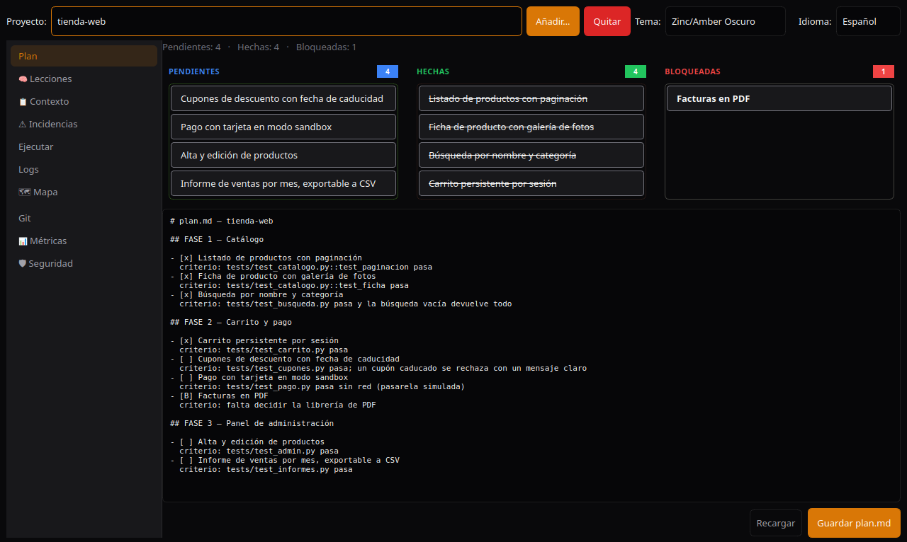
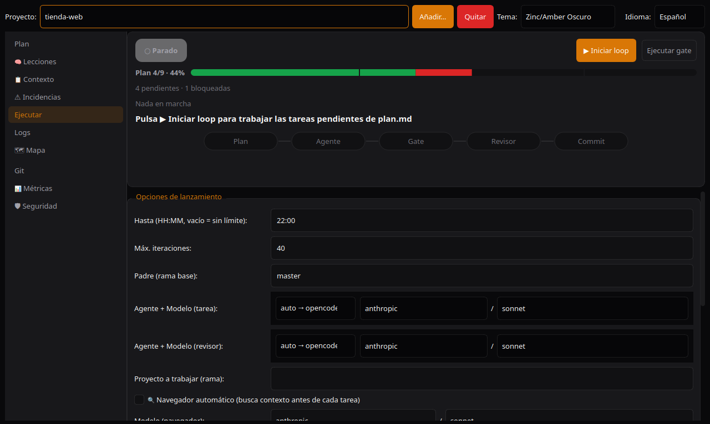

[English](README.md) · **Español**

# Dédalo

[](https://github.com/BenReynor/dedalo/actions/workflows/ci.yml)
[](https://github.com/BenReynor/dedalo/actions/workflows/release.yml)
[](https://github.com/BenReynor/dedalo/releases)
[](LICENSE)
[](pyproject.toml)
[](#-compatibilidad)

**Un panel de escritorio que convierte una lista de tareas en Markdown en commits
terminados, probados y revisados, hechos por agentes de IA mientras tú miras.**

Escribes `plan.md` (una tarea por línea, cada una con la condición que demuestra
que está hecha). Dédalo le pasa las tareas una a una a un agente de IA por línea
de comandos (`claude` u `opencode`), ejecuta los tests y el lint de tu proyecto,
hace que un segundo modelo revise el diff, juzga el resultado contra tu
condición y solo entonces hace el commit. Las tareas que fallan se reintentan o
se marcan como bloqueadas con una lección, así el plan sigue avanzando.

La interfaz está en **inglés por defecto**; cámbiala a español con el selector
**Language** de la barra superior.

| Tablero y editor del plan | Cabina de ejecución |
|---|---|
|  |  |

**¿Prefieres un ejecutable listo?** Descárgalo de
[Releases](https://github.com/BenReynor/dedalo/releases) (Linux `.deb`/`.AppImage`/`.tar.gz`,
Windows `.zip`), o sigue el [Inicio rápido](#-inicio-rápido) para ejecutarlo desde el código.

> [!WARNING]
> **Windows es experimental y no se ha probado en un PC real.** Dédalo se
> desarrolla y se usa en Linux. En Windows los tests pasan en el CI y el
> `dedalo.exe` empaquetado arranca, pero nadie ha probado aún el instalador, la
> bandeja ni un loop real con un agente. Úsalo bajo tu responsabilidad y
> [abre un issue](https://github.com/BenReynor/dedalo/issues) con lo que falle.
> Ver [Compatibilidad](#-compatibilidad).

> **¿Trabajas con una IA en este proyecto?** Mira
> [`docs/FICHA_TECNICA.md`](docs/FICHA_TECNICA.md) —requisitos, dependencias,
> plataformas, superficie MCP y seguridad en un solo archivo pensado para que un
> modelo (y una persona técnica) entienda de un vistazo qué es Dédalo— o el
> índice [`llms.txt`](llms.txt), pensado para que un LLM sepa qué hay sin
> recorrer todo el repositorio.

---

## 📑 Índice

- [Inicio rápido](#-inicio-rápido)
- [Qué hace](#-qué-hace)
- [Cómo funciona el loop](#-cómo-funciona-el-loop)
- [Consejos de uso](#-consejos-de-uso)
- [Atajos de teclado](#-atajos-de-teclado)
- [Temas (9)](#-temas-9)
- [Ajustes persistentes](#-ajustes-persistentes)
- [Notificaciones](#-notificaciones)
- [Añadir un proyecto que ya tiene contenido](#-añadir-un-proyecto-que-ya-tiene-contenido)
- [Catálogo de modelos](#-catálogo-de-modelos)
- [Requisitos de un proyecto gestionado](#-requisitos-de-un-proyecto-gestionado)
- [Plantillas de gate](#-plantillas-de-gate)
- [Desinstalar / quitar un proyecto](#-desinstalar--quitar-un-proyecto)
- [Compatibilidad y descargas](#-compatibilidad)
- [Variables de entorno del loop](#-variables-de-entorno-del-loop)
- [Servidor MCP (agente piloto)](#-servidor-mcp-agente-piloto)
- [Seguridad](#-seguridad)
- [Desarrollo](#-desarrollo)
- [Estructura principal](#-estructura-principal)
- [Solución de problemas](#-solución-de-problemas)
- [Fallos conocidos abiertos](#-fallos-conocidos-abiertos)

---

## 🚀 Inicio rápido

**Antes de empezar:** Python 3.10+, `git` y al menos un agente por línea de
comandos (`opencode` o `claude`) instalado y con la sesión iniciada. No hace
falta nada más para el panel ni para el loop; `bash` solo se necesita para un
`mapear.sh` personalizado y el motor antiguo opcional.

```bash
# Clonar
git clone https://github.com/BenReynor/dedalo.git
cd dedalo

# Instalación automática: crea .venv, instala con soporte MCP y
# crea el acceso directo del escritorio.
bash install.sh

# Ejecutar: doble clic en el icono «Dédalo» del escritorio, o desde la terminal:
./lanzar.sh
```

> En Debian/Ubuntu, si falta el módulo venv: `sudo apt install python3-venv`.

<details>
<summary>Instalación manual (paso a paso)</summary>

```bash
# Entorno virtual (recomendado; evita el error PEP 668 de las distribuciones)
python3 -m venv .venv
source .venv/bin/activate

# Dependencias (con soporte MCP)
pip install -e ".[mcp]"
# o mínimas, sin MCP: pip install PySide6 pyqtgraph

# Dependencias de desarrollo (tests/lint)
pip install -e ".[dev]"

# Ejecutar
python -m dedalo
```
</details>

> **Python**: necesita 3.10+.

> **Reparar o empezar de cero**: `rm -rf .venv && bash install.sh` reconstruye
> el entorno desde cero con una sola orden, sin tocar tus proyectos, modelos ni
> ajustes de notificaciones.

---

## 🎯 Qué hace

| Función | Descripción |
|---------|-------------|
| **Plan** | Kanban + editor Markdown de `plan.md` (tareas `- [ ]`, hechas `- [x]`, bloqueadas `- [B]`). |
| **Lecciones** | Editor de `lecciones.md` (memoria del proyecto): se inyecta al agente antes de cada tarea y se añade una entrada cuando una tarea se bloquea. |
| **Progreso** | Cada tarea terminada se commitea junto con su `plan.md` y `lecciones.md` actualizados: la rama cuenta la historia completa, no solo el código. |
| **Incidencias** | Tabla de `incidencias.jsonl` (hora, iteración, tarea, tipo, motivo): fallos, abortos y bloqueos con su causa real. |
| **Ejecutar** | Lanza el loop: agente → gate → revisor → commit. Parámetros: hora límite, iteraciones, rama base, coste máximo, revisión dual/manual. Una **cabina** arriba muestra la ejecución de un vistazo: estado y reloj, avance del plan por `## FASE`, la tarea e intento actuales, el recorrido de fases (Plan → Agente → Gate → Revisor → Commit; haz clic en una fase para ver lo que produjo) y una línea de tiempo con una estimación de lo que falta. Los loops lanzados desde MCP se ven igual. |
| **Logs** | Salida en vivo de `progreso.log` (loop) y `gate.sh`. Plegable (⛶) con la cabecera siempre visible. Desplazamiento automático. |
| **Mapa** | Visor de `mapeo.txt`: módulos, tests (con sus nombres), rutas HTTP (Django, Flask, FastAPI, Express, actix/axum, Go) y comandos CLI (argparse, click/typer). Se genera en Python para cualquier stack; **Regenerar** lo reconstruye. Un `mapear.sh` que hayas personalizado sigue teniendo prioridad. |
| **Métricas** | Panel en tiempo real: tareas hechas por iteración, coste estimado acumulado (ámbar), gate OK/FAIL, revisor PASS/FAIL. Exporta CSV. |
| **Git** | Historial de commits del proyecto, revertir rápido. |
| **Seguridad** | Límite de temperatura de la CPU (apagado seguro), webhooks (Telegram, Discord, WhatsApp). |

> **Contexto del proyecto (`CONTEXTO.md`)**: un archivo permanente que describe
> *de qué va el proyecto* (qué hace, requisitos, filosofía, estructura). El loop
> **lo inyecta en los prompts del agente y del revisor** en cada iteración, para
> que trabajen con el enfoque del proyecto y no a ciegas. A diferencia de
> `lecciones.md` (lecciones aprendidas, crece solo) y `plan.md` (tareas), el
> contexto es estable y lo escribes tú. Se instala como esqueleto en cada
> proyecto y **nunca se sobrescribe**. No tiene panel en la interfaz: edítalo con
> tu editor.

---

## 🔁 Cómo funciona el loop

Dédalo convierte una lista de comprobación en Markdown en una cadena de entrega.
Apúntalo a un proyecto y recorre `plan.md` en orden, una tarea cada vez:

1. **Elige** la primera tarea pendiente (`- [ ]`) e inyecta `CONTEXTO.md` y
   `lecciones.md` en el prompt del agente.
2. **La implementa** con el agente elegido (`opencode`, `claude` o `auto`), en
   su propia rama de tarea creada desde la rama de la ejecución.
3. **Pasa el gate**: los checks propios del proyecto (`gate_checks/`) deben pasar.
4. **Revisa** el diff con un segundo agente y modelo (revisión dual, activada por
   defecto), para que no se cuele un cambio que solo «parece hecho».
5. **Hace el commit** de la tarea en su rama y la integra (fast-forward) en la
   rama de la ejecución; `plan.md` y `lecciones.md` se commitean con ella, así la
   rama registra qué se hizo y qué se aprendió.
6. **Sigue** con la siguiente tarea. Al final, si indicaste una rama de trabajo
   (`--trabajo`), la rama de la ejecución se integra en ella; después, si el push
   está activado, se publica.

Si el gate o el revisor rechazan el trabajo, el loop reintenta la tarea. Cuando
se acaban los intentos, la marca `[B]`, escribe una lección y una incidencia, te
avisa y sigue, en vez de atascar todo el plan. Con la revisión manual activada,
se detiene **antes de cada commit** y espera tu `APPROVE`/`REJECT`.

Dos salvaguardas lo hacen predecible: el loop se detiene si no hay internet, y se
detiene antes de empezar una iteración nueva cuando se agota el presupuesto
**estimado** (`MAX_COSTO`).

### Formato del plan

```markdown
## Tareas (en orden de dependencias)

- [ ] #1 Añadir el botón de exportar CSV al panel de métricas.
      criterio: tests/test_metrics.py::test_export_csv pasa y falla sin el cambio.
- [ ] #2 Documentar la exportación en el README.
      criterio: README.md tiene un párrafo «Exportar»; sin cambios de código.
- [x] #3 Tarea anterior, ya hecha.
- [B] #4 Tarea bloqueada, esperando una decisión.
```

- Una tarea por línea, escrita como un resultado, no como un área vaga.
- La línea opcional `criterio:` es la condición **literal** de aprobado/suspenso
  que comprueba el juez (también puedes ponerla en la misma línea de la tarea).
  Sé concreto: archivos, tests, comandos. El loop no adivina qué significa
  «mejorar la interfaz».
- Para que el agente use una de tus skills (Claude Code u opencode), basta con
  nombrarla en la tarea o en su criterio, p. ej. `Rediseñar la vista de ajustes
  usando la skill estilo-retro`. El agente carga las skills que nombra la tarea
  (y solo esas); el revisor comprueba el diff contra ellas.
- Si el juez no puede dar un veredicto (error del agente, sin créditos, tiempo
  agotado, respuesta ilegible), el loop vuelve a ejecutar **solo el gate** dos
  veces (pausa: `ESPERA_JUEZ`, 10 s por defecto). Si sigue sin poder juzgar, el
  loop **se detiene** (código de salida 8, notificación de error) y deja la tarea
  `[ ]`: un criterio sin verificar nunca cuenta como hecho. Una ejecución manual
  del gate (botón de la interfaz, `correr_gate` por MCP) solo avisa.
- Si falla el commit de una tarea, el loop **se detiene** (código de salida 9)
  sin marcarla como hecha y deja la rama de la tarea y sus cambios intactos, con
  el error de git en progreso.log: el trabajo nunca queda suelto para que lo
  recoja la siguiente tarea.
- `[x]` es hecha, `[B]` es bloqueada. El loop escribe las dos; puedes editar el
  archivo a mano para reintentar o reordenar.
- El orden es el de dependencias: el loop siempre toma la primera tarea pendiente.

### Costes y presupuesto

Dédalo **no** lee la factura de tu proveedor. Estima el gasto con los valores que
configuras: cada intento de implementación suma `COSTO_POR_ITER` y una revisión
dual suma la mitad. `MAX_COSTO` se comprueba antes de empezar cada iteración;
cuando la estimación acumulada lo alcanza, el loop se detiene limpiamente. Úsalo
como salvaguarda y mira el panel de tu proveedor para las cifras reales.

---

## 💡 Consejos de uso

- **Empieza por el contexto.** Un `CONTEXTO.md` claro y un `plan.md` con tareas
  pequeñas y verificables dan mejores resultados que prompts largos: el loop
  inyecta `CONTEXTO.md` en el agente y el revisor en *cada* iteración.
- **`auto` ya elige bien.** Toma la primera CLI instalada *y con sesión*; si un
  agente aparece como `claude (sin login)`, inicia sesión o elige otro.
- **Primer contacto con el repo de otra persona: activa la revisión manual.** Con
  `REVISION_MANUAL=1` el loop se detiene antes de cada commit y espera tu
  `APPROVE`.
- **Pon un tope de gasto.** `MAX_COSTO` limita el gasto **estimado** (intentos ×
  `COSTO_POR_ITER`, en USD); es una salvaguarda, no la factura de tu proveedor.
  Ponlo antes de dejar el loop solo.
- **Las fichas JSON son opcionales.** La pestaña Ejecutar tiene una casilla para
  escribir un `.dedalo/fichas/*.json` por tarea aceptada. Usa una llamada extra
  al agente, así que está desactivada por defecto; un fallo nunca bloquea el commit.
- **No edites a mano los 3 scripts del framework** (`dedalo.sh`, `gate.sh`,
  `mapear.sh`): se renuevan al abrir el proyecto. Si los tocas, haz commit antes.
- **Mantén el gate rápido.** Se ejecuta en cada iteración; un gate lento
  ralentiza todo el ciclo.
- **Tu configuración vive en `~/.config/dedalo/`.** Cópiala antes de
  experimentar; si quieres empezar de cero, bórrala.
- **El binario empaquetado no incluye el MCP por stdio** (se compila sin
  consola): para el «agente piloto» MCP, usa el código fuente.
- **Verifica las descargas.** Comprueba los `SHA256SUMS*` de cada Release antes
  de ejecutar un binario.

---

## ⌨️ Atajos de teclado

| Tecla | Acción |
|-------|--------|
| `Ctrl+1` … `Ctrl+9` | Cambiar de pestaña (Plan, Lecciones, Incidencias, Ejecutar, Logs, Mapa, Git, Métricas, Seguridad) |
| `Ctrl+Q` | Salir |

---

## 🎨 Temas (9)

| Tema (nombre en la interfaz) | Estilo |
|------|--------|
| **Oscuro** | Pizarra/azul clásico oscuro |
| **Claro** | Pizarra/azul clásico claro |
| **Hacker** | Verde terminal |
| **Cyberpunk** | Neón fucsia/morado sobre grafito |
| **Zinc/Amber Oscuro** | Cabina ámbar (por defecto) |
| **Gray/Red Oscuro** | Rojo |
| **Stone/Emerald Claro** | Verde claro cálido |
| **Zinc/Sky Claro** | Azul claro |
| **Slate/Teal Oscuro** | Verde azulado profundo |

Se cambia en vivo desde el selector «Theme» de la barra superior. Los nombres de
los temas son fijos; el resto de la interfaz sigue al selector de idioma.

---

## ⚙️ Ajustes persistentes

Se guardan en `~/.config/dedalo/proyectos.json`:

- Proyectos registrados (ruta + configuración de cada proyecto)
- Tema activo
- Seguridad térmica
- Webhooks
- Modelos elegidos
- **Ancho de la barra lateral** (`sidebar_ancho`)

Dos datos del estado de la ventana no viven ahí, sino en `QSettings` de Qt
(`~/.config/dedalo/panel.conf`): la geometría de la ventana y el proyecto que
estaba activo.

El registro se escribe de forma atómica (archivo temporal + `os.replace()`), así
que un corte de luz a mitad de escritura no lo deja a medias. Aun así, si el JSON
llega a corromperse, la app **no arranca**: te dice dónde está el problema, deja
una copia `proyectos.json.corrupto` (sin sobrescribir una anterior) y ofrece dos
salidas:

- **Salir y arreglarlo a mano** (por defecto): el original queda intacto y, si
  vuelves a abrir, te avisa otra vez en lugar de perder el registro en silencio.
- **Empezar de cero**: solo entonces se descarta el original, y la copia se
  conserva por si hay que recuperar algo a mano.

---

## 🔔 Notificaciones

Un loop solo sirve si puedes dejarlo trabajar solo. Dédalo te avisa por
**Telegram, Discord o WhatsApp** en los momentos que importan, tanto si el loop
se lanzó desde el panel, desde un agente piloto MCP o desde el motor de Python en
una terminal.

| Evento | Qué recibes |
|---|---|
| Loop iniciado (panel) | Proyecto y modelos elegidos. |
| Loop iniciado (MCP / CLI) | Proyecto, modelos elegidos **y** el origen. |
| Tarea completada | Nombre de la tarea, iteración, rama y commit. |
| Tarea bloqueada | La tarea que necesita tu atención. |
| Loop terminado | Tareas hechas/total, coste estimado y duración. |
| Tokens/cuota agotados | El loop se detuvo porque el modelo se quedó sin cuota. |
| Error crítico | El motivo exacto por el que se abortó la ejecución. |

### Configurarlas

Abre **Seguridad → Notificaciones** y rellena solo el canal que quieras:

- **Telegram:** el `Bot Token` de [@BotFather](https://t.me/BotFather) y el
  `Chat ID` numérico (envía antes un mensaje al bot y léelo en
  `https://api.telegram.org/bot<token>/getUpdates`).
- **Discord:** la URL del webhook del canal (Ajustes del servidor → Integraciones).
- **WhatsApp:** URL de la API de Meta Cloud, token de acceso, ID del número de
  teléfono y el número de destino en formato internacional.

Pulsa **🧪 Probar** en ese canal y después actívalo. Los siete interruptores de
**Eventos a notificar** deciden qué se envía; los que falten cuentan como
activados. El panel edita el proyecto activo: los valores se guardan como valores
por defecto globales y como configuración propia de ese proyecto, así un proyecto
puede avisarte al móvil mientras otro se queda en silencio.

- **Sin duplicados.** El panel y el motor se ponen de acuerdo en quién informa de
  qué, así que una ejecución desde la interfaz nunca envía cada evento dos veces.
- **Sin fallos silenciosos.** Si un canal rechaza un mensaje (token incorrecto,
  chat id equivocado), el motivo queda en `progreso.log` en vez de perderse.
- **Guardado con cuidado.** Los tokens viven en `~/.config/dedalo/proyectos.json`,
  creado con permisos `0600` (solo tu usuario).

Las notificaciones son **de mejor esfuerzo**: un webhook roto nunca detiene el loop.

---

## 📂 Añadir un proyecto que ya tiene contenido

El selector de carpeta acepta cualquier directorio existente, no solo uno vacío.
Conviene saber qué toca la app en cada caso:

| | Qué hace |
|---|---|
| Archivos que faltan (`plan.md`, `lecciones.md`, `CONTEXTO.md`, `.gitignore`, scripts) | Los copia de la plantilla. **Nunca sobrescribe un archivo existente.** |
| `plan.md`, `lecciones.md`, `CONTEXTO.md`, `.dedalo/scripts/gate_checks/*` | Contenido tuyo. Nunca se compara ni se sobrescribe. |
| `dedalo.sh`, `gate.sh`, `mapear.sh` (en `.dedalo/scripts/`) | **Se sobrescriben** al abrir el proyecto si difieren de la plantilla. Si los editaste a mano, haz commit antes. |
| Un proyecto instalado con una versión antigua | Sus archivos del framework en la raíz pasan a `.dedalo/` una vez, automáticamente. |
| Directorio sin repo de git | Ejecuta `git init -b master` y hace un commit inicial con lo que haya (`git add -A`). |

Es decir: tu código y tus documentos están a salvo; los tres scripts del
framework se tratan como código de soporte y se renuevan solos.

---

## 🌐 Catálogo de modelos

Los modelos vienen de `https://models.dev/api.json` y el catálogo se guarda en
caché **7 días** (`modelos.CATALOGO_HORAS`). Cambiar de proveedor lanza una
consulta nueva; el resto de la sesión usa la caché, así que refrescar la
interfaz no toca la red. Si no hay red, se sirven los datos en caché y el log lo
indica.

---

## 🔧 Requisitos de un proyecto gestionado

Cada proyecto tiene en su raíz:

```
mi-proyecto/
├── plan.md            # lista de tareas
├── lecciones.md       # memoria del proyecto
├── CONTEXTO.md        # contexto permanente (se inyecta al agente y al revisor)
└── .dedalo/           # código del framework + estado de ejecución (en .gitignore)
    ├── scripts/
    │   ├── dedalo.sh  # motor bash (OBSOLETO; la interfaz usa el motor Python)
    │   ├── gate.sh    # comprobaciones (tests, lint, etc.)
    │   ├── mapear.sh  # genera mapeo.txt
    │   └── gate_checks/ # TUS checks: nunca se sobrescriben
    ├── estado/
    │   ├── progreso.log     # lo escribe el motor (la interfaz lo lee)
    │   ├── metrics.jsonl
    │   ├── incidencias.jsonl
    │   └── mapeo.txt
    └── review/              # decisión manual pendiente (APPROVE/REJECT)
```

Aquí conviven dos tipos de archivos:

- **Tuyos, versionados:** `plan.md`, `lecciones.md`, `CONTEXTO.md` y tu código.
  Dédalo crea los archivos de memoria si faltan y nunca los sobrescribe;
  commitéalos con el resto de tu trabajo.
- **Tuyos, locales:** `gate_checks/`. Dédalo nunca sobrescribe tus checks, pero
  viven dentro de `.dedalo/` (ignorado por git), así que no se commitean por
  defecto. Guarda una copia fuera de `.dedalo/` (o añádelos a la fuerza) si los
  quieres versionados.
- **Del framework:** los scripts (`dedalo.sh`, `gate.sh`, `mapear.sh`), sus
  versiones portables en Python y todo lo que hay en `.dedalo/estado/` y
  `.dedalo/review/`. Los que faltan se recrean, y los scripts se actualizan desde
  la plantilla (con una copia con fecha) cuando difieren. `.gitignore` mantiene
  todo esto fuera de tu repositorio.

En resumen: la app repara su propio andamiaje, pero **no** regenera tus checks
del gate ni la memoria del proyecto.

**Entorno virtual del proyecto.** Si el proyecto tiene `.venv/` (o `venv/`), el
loop pone su `bin/` (`Scripts\` en Windows) el primero en el `PATH` y define
`VIRTUAL_ENV` para el agente, el gate y el juez. Las plantillas del gate y los
comandos permitidos al agente llaman a `pytest`, `ruff` o `python` por su nombre,
así que se ejecutan con las dependencias del proyecto y no con las del sistema.
Créalo como prefieras (p. ej. `uv venv` + `uv pip install -r requirements.txt`).

El motor del loop es `dedalo/loop.py` (una versión del script original, nacida en
`W2`, con el mismo log y la misma observabilidad). La interfaz lo lanza con su
propio intérprete (`python -m dedalo.loop`, o `--dedalo-loop` dentro del binario
empaquetado) y ya no necesita bash para arrancar. Los archivos `dedalo.sh`,
`gate.sh` y `mapear.sh` se copian automáticamente al crear o abrir un proyecto
desde la plantilla del repo (`dedalo/plantillas_data/`); `dedalo.sh` se conserva
como referencia y para ejecuciones manuales en una terminal POSIX.

---

## 🛠️ Plantillas de gate

Cada proyecto usa **una o varias plantillas de gate**, elegidas en el panel
**Ejecutar** (o con `instalar_proyecto` por MCP) y cambiables en cualquier
momento; cada una es un conjunto de checks portables en Python para un lenguaje o
stack. Las plantillas viven en `dedalo/plantillas_data/plantillas/` y se instalan
en `.dedalo/scripts/gate_checks/` de tu proyecto con un sufijo de lenguaje, para
que varios stacks convivan sin chocar (`03_test_rust.py`, `03_test_go.py`, etc.).

| Plantilla | Detecta | Checks (si la herramienta está instalada) |
|---|---|---|
| `web` | `index.html` | Estructura HTML5, propiedades CSS personalizadas + responsive, cambio de tema en JS + sintaxis |
| `python` | `pyproject.toml` / `requirements.txt` | `ruff check .`, `pytest -q` (si hay `tests/`) |
| `node` | `package.json` | `package.json` válido, `npm run lint`, `npm test`, `tsc --noEmit` (si hay `tsconfig.json`) |
| `rust` | `Cargo.toml` (o `src-tauri/Cargo.toml` en apps Tauri) | `cargo fmt --check`, `cargo check`, `cargo test` |
| `go` | `go.mod` | `gofmt -l .`, `go vet ./...`, `go test ./...` |
| `java` | `pom.xml` / `build.gradle` | `mvn -q -B -DskipTests compile` / `gradle compileJava`, `mvn test` / `gradle test` |
| `kotlin` | `build.gradle.kts` / `*.kt` | `gradle compileKotlin`, `gradle test` |
| `csharp` | `*.sln` / `*.csproj` | `dotnet build`, `dotnet test` |
| `cpp` | `CMakeLists.txt` / fuentes C/C++ | `clang-format --dry-run --Werror`, build con CMake/make, `ctest` / `make test` |
| `shell` | `*.sh` | sintaxis `bash -n`, `shellcheck -x` |
| `ruby` | `Gemfile` | `rubocop` (con `bundle exec`), `rspec` / `rake test` |
| `php` | `composer.json` | `php -l` en cada `.php`, `phpunit` (vendor/bin) |
| `swift` | `Package.swift` | `swift build`, `swift test` |
| `dart` | `pubspec.yaml` | `dart analyze`, `dart test` |
| `generic` | cualquier marcador conocido | detecta el stack y ejecuta los comandos estándar (úsala **sola**, no combinada) |

**Cómo funciona:**
- Interfaz (panel **Ejecutar** → *Plantillas de gate*):
  - escribe una lista separada por comas o elige una de las 5 últimas usadas en
    ese proyecto;
  - **Autodetectar** lee los archivos del proyecto (tabla de arriba) y aplica las
    plantillas que encajan (usa `python` si no encaja ninguna);
  - **Editar plantillas…** abre una lista de casillas.
  Cambiar de stack quita los checks del stack anterior **solo si nunca los editaste**.
- Los proyectos nuevos no muestran diálogo: empiezan con los checks por defecto
  de Python/backend hasta que eliges plantillas.
- MCP: `instalar_proyecto(ruta, plantilla="rust,go")` (separadas por comas o
  espacios), o `plantilla="auto"` para detectarlas.
- La selección se guarda en `.dedalo/plantilla` (una por línea) y se conserva al
  volver a abrir el proyecto.
- Los checks cuya herramienta falta (`cargo`, `dotnet`, `swift`, etc.) **se
  omiten con un aviso**, no fallan: un gate de varios stacks pasa en una máquina
  que solo tiene algunas herramientas.
- Los fallos se informan por lenguaje (`[GATE] ✗ rust: 03_test_rust.py falló`) y
  **se ejecutan todos los checks aunque uno falle**: ves el panorama completo.
- Tus propios checks van en `gate_checks/99_custom.py` (o `NN_mi_check.py`); nunca
  se sobrescriben.

---

## 🧹 Desinstalar / quitar un proyecto

**Quitar un proyecto de la lista.** Detén antes su loop y usa *Quitar proyecto*.
Es **destructivo e irreversible** para los archivos de Dédalo: borra `.dedalo/`
(scripts, checks y estado), `plan.md`, `lecciones.md` y `CONTEXTO.md`. El código
de tu aplicación nunca se toca. Haz commit o copia antes los archivos de memoria
si puedes necesitarlos. Quitar una entrada *huérfana* (cuya carpeta ya no existe)
solo borra la entrada.

**Desinstalar la app.** El instalador crea un lanzador, un acceso directo en el
escritorio y un icono. Basta con quitarlos junto con el entorno virtual; tus
proyectos se quedan donde están:

```bash
# Desde la copia de Dédalo
rm -rf .venv
rm -f ~/.local/bin/dedalo
rm -f ~/Escritorio/dedalo.desktop ~/Desktop/dedalo.desktop
rm -f ~/.local/share/icons/hicolor/scalable/apps/dedalo.svg
```

Tus ajustes viven fuera de la copia, en `~/.config/dedalo/`. Borra esa carpeta
solo si también quieres olvidar la lista de proyectos, los gates de confianza,
los tokens de los webhooks y los ajustes de la ventana.

---

## 🖥️ Compatibilidad

> **Dédalo funciona en Linux.** El soporte de Windows es **experimental**: todos
> los tests pasan en el CI de Windows (sin pantalla) y el workflow de release
> compila y arranca la app empaquetada, pero no se ha usado a diario en un
> Windows real. Informa de lo que falle.

| Sistema | Estado |
|----|--------|
| **Linux** | ✅ **Soportado.** Entorno de referencia: uso diario más los tests del CI. |
| **Windows** | 🧪 **Experimental.** El CI ejecuta todos los tests en `windows-latest` con Git Bash real. La interfaz, el loop (`dedalo/loop.py`) y el gate (`dedalo/gate.py`) son motores nativos en Python lanzados con el intérprete de la propia app, así que **no hace falta Git Bash** (`os.pathsep`, sufijos `.exe`/`.cmd`). **Sin probar en un PC real:** instalador y acceso directo, bandeja y un loop real con opencode o claude. Bash (Git Bash o WSL) solo hace falta para el motor bash opcional (`dedalo.sh`) o un `mapear.sh` personalizado; el mapa del proyecto se genera en Python. |

Lo que ya es independiente del sistema: los finales de línea de los `.sh`
(`.gitattributes` fuerza `eol=lf`, así un `clone` en Windows con `autocrlf` ya
no rompe el shebang) y el formato numérico (`LC_ALL=C`: con un locale español,
`awk`/`printf` escribían `0,500000` y `metrics.jsonl` quedaba como JSON inválido).

`tests/test_portabilidad.py` es la salvaguarda: falla si alguien vuelve a
introducir algo no portable. La lista de bloqueos pendientes en Windows está al
final de ese archivo, con el motivo de cada uno.

### 📦 Descargas (Release)

Los binarios por plataforma se publican en [Releases](https://github.com/BenReynor/dedalo/releases)
al subir una etiqueta `v*` (Linux: `.tar.gz`/`.deb`/`.AppImage`; Windows,
experimental: `.zip` con `dedalo.exe`). Los ejecutables **no están firmados**:
al instalarlos, el sistema pedirá una confirmación explícita:

| Sistema | Primera vez |
|----|-----------------|
| **Windows** | SmartScreen avisará: *Más información → Ejecutar de todas formas*. |
| **Linux** | Sin firma ni sandbox; la procedencia es este repositorio (las sumas están en la propia Release). |

Cada Release incluye sus `SHA256SUMS*`; verifícalos con
`sha256sum -c SHA256SUMS[-windows]`.

La validación completa (interfaz más un loop real con un agente como opencode)
está documentada paso a paso, por sistema, en
[packaging/PRUEBA-MANUAL.md](packaging/PRUEBA-MANUAL.md).

#### 🏷️ Etiquetas y versiones

La última versión es `v2.2.1`; las etiquetas anteriores son `v2.2.0` (sin
release: falló su build de Linux), `v2.1.0`, `v2.0.0`, `v2.0.1` (antes del cambio
de nombre) y `v2.0.2` (ya como Dédalo). Cada etiqueta `v*` lanza
`.github/workflows/release.yml`, que compila y publica una Release con los
binarios de cada sistema. Conviene saber:

- Las Releases **v2.0.0 / v2.0.1 son anteriores al cambio de nombre**: su título
  es *«Autopiloto v2.0.x»* y sus archivos se llaman `autopiloto-gui-*`. **Se
  siguen descargando** (es código funcional de la época anterior a Dédalo), pero
  **no reflejan el código actual del repo**.
- Desde **v2.0.2**, los archivos se generan como `dedalo-<versión>-…` y el título
  de la Release es *«Dédalo»*.
- Los enlaces *Full Changelog* de las Releases antiguas apuntan al nombre antiguo
  `autopiloto-gui`; GitHub **redirige** los repos renombrados, así que no dan 404.
- **Temas del repositorio**: se gestionan con `gh repo edit --add-topic <tema>`
  (independientes de las etiquetas de git).

---

## 🔧 Variables de entorno del loop

El motor del loop (`dedalo/loop.py`, una versión en Python del `dedalo.sh`
original, que la interfaz ya no usa) se configura con variables de entorno (la
interfaz las rellena desde el formulario Ejecutar). Las más útiles:

| Variable | Descripción |
|----------|-------------|
| `AGENTE_TAREA` | Agente que implementa: `opencode`\|`claude`\|`auto` (por defecto). |
| `AGENTES_PREFERIDOS` | Orden de preferencia para `auto` y el revisor. |
| `MODELO_TAREA` | Modelo de la tarea `proveedor/modelo` (solo opencode). |
| `AGENTE_REVISOR` / `MODELO_REVISOR` | Agente y modelo de la revisión dual (revisor del diff). |
| `AGENTE_JUEZ` | Agente juez del `criterio:` (por defecto, el de la tarea). |
| `REVISION_DUAL` | `1` activa el revisor (por defecto), `0` lo desactiva. |
| `REVISION_MANUAL` | `1` se detiene antes de cada commit y espera tu aprobación en la interfaz. |
| `TIMEOUT_REVISION_MANUAL` | Segundos máximos de espera de la aprobación manual; al vencer, la tarea se marca `[B]` y el loop sigue (`0` = sin límite). Por defecto: `1800`. |
| `MAX_COSTO` | Presupuesto estimado en USD, comprobado antes de cada iteración (`0` = sin límite). |
| `COSTO_POR_ITER` | USD estimados por intento (por defecto `0.50`); la revisión dual suma la mitad. |
| `VOZ` | `1` activa avisos con `notify-send`/`spd-say`. |
| `NAVEGADOR` / `MODELO_NAVEGADOR` | Navegador de contexto automático antes de cada tarea. |
| `CRITERIO` | Se extrae de la línea `criterio:` bajo la tarea en `plan.md`. |
| `REVISION_APRUEBA_AGENTE` | `1` deja que un agente piloto apruebe su propia revisión manual (por defecto `0`: el `APPROVE` de un agente se ignora y el loop sigue esperando a una persona). |
| `FICHA_ACTIVA` | `1` escribe una ficha JSON por tarea aceptada en `.dedalo/fichas/` (por defecto `0`: desactivado, sin tokens extra). |
| `AGENTE_FICHA` / `MODELO_FICHA` | Agente/modelo del observador de fichas (`auto` = el mismo que la tarea). |
| `TIMEOUT_FICHA` | Segundos para la llamada del observador (por defecto `120`). |
| `FICHAS_DIR` | Sustituye `.dedalo/fichas` (relativo al proyecto o absoluto). |
| `FICHA_MAX_DIFF` | Caracteres máximos del diff guardados en la ficha (por defecto `12000`). |
| `FICHA_MAX_SALIDA` | Caracteres máximos de la salida del gate/agente (por defecto `20000`). |
| `FICHA_DIFF_COMPLETO` | `1` guarda el diff completo (por defecto `0`). |
| `DEDALO_GATE_CONSENT` | `1` confía en el gate del proyecto sin preguntar (para CI/scripts). Sin definir = pregunta una vez por proyecto (interactivo) o aborta. |

> Mientras espera la `REVISION_MANUAL`, si se cae la red el loop aborta (en vez de
> quedarse colgado); y si vence `TIMEOUT_REVISION_MANUAL`, la tarea se marca `[B]`.
>
> Las fichas usan el formato de
> `dedalo/plantillas_data/skills/ficha-dedalo/SKILL.md`; el motor lo inyecta en
> el prompt del observador, así que funciona con opencode y con claude.
>
> Estas variables (y todas las que empiezan por `DEDALO_`, `CLI_`, `LC_`,
> `OPENCODE_` y `CLAUDE_`) se pasan siempre. Cualquier **otra** variable que
> necesites en el motor o el gate hay que habilitarla con `DEDALO_ENTORNO_EXTRA`:
> ver [Seguridad](#-seguridad).

### Agentes por línea de comandos

`auto` (por defecto) elige la primera CLI instalada según `AGENTES_PREFERIDOS`
(`opencode claude`). La interfaz solo muestra los agentes que encuentra en la
máquina e indica el detectado en la opción `auto`, así que nunca ofrece uno que
no existe.

- `opencode` se invoca con `opencode run --agent <agente> --dir <proyecto>`.
  Dédalo define sus propios agentes con `OPENCODE_CONFIG_CONTENT` (combinado con
  tu configuración) y desactiva todos tus servidores MCP en esas ejecuciones, el
  mismo aislamiento que `--strict-mcp-config` en claude:
  - **agente de tarea** (`dedalo-tarea`): puede editar y ejecutar comandos, nunca `git`.
  - **revisor, juez, navegador y ficha** (`dedalo-lectura`): solo lectura (sin
    editar, escribir, bash, subagentes ni web).
  - `OPENCODE_AGENT_TAREA`, `OPENCODE_AGENT_LECTURA`, `OPENCODE_AGENT_NAV` y
    `OPENCODE_AGENT_JUEZ` los sustituyen.
- `claude` se invoca con `claude -p --output-format text --strict-mcp-config`
  (nunca carga tus servidores MCP) y recibe el prompt por stdin. Los permisos
  dependen del rol:
  - **agente de tarea:** puede editar archivos (`acceptEdits`) y ejecutar sin
    preguntar los comandos de las plantillas de gate del proyecto (python →
    `pytest`, `python`, `ruff`; node → `npm`, `node`; rust → `cargo`…). Nunca
    `git`: las ramas y los commits los gestiona el loop. `CLAUDE_FLAGS` añade
    opciones extra solo a este rol.
  - **revisor, juez (`98_criterio`), navegador y ficha:** solo lectura (`Edit`,
    `Write`, `Bash`… no permitidos).
- `opencode` acepta cualquier `proveedor/modelo`; `claude` acepta modelos de
  Anthropic (`anthropic/haiku`, `anthropic/sonnet`, `anthropic/opus` o un id
  completo `claude-*`). Elegir `claude` en la interfaz cambia un modelo que no es
  de Claude a `anthropic/haiku`, el más barato.
- Si una CLI está instalada pero sin sesión (`Not logged in`, 401, API key no
  válida), el loop se detiene con un aviso claro en vez de marcar tareas como
  fallidas por un error de autenticación.
- Al arrancar, la interfaz comprueba en segundo plano si cada CLI tiene sesión:
  las que no la tienen aparecen como `claude (sin login)` y no se pueden elegir.
  La comprobación se guarda en caché y no bloquea la interfaz; el botón de
  refrescar modelos la repite.
- En `opencode` la sesión no se puede determinar sin ambigüedad (siempre responde
  0 y los modelos de su catálogo no necesitan credenciales), así que se considera
  usable y se marca como «sesión sin verificar».

---

## 🤖 Servidor MCP (agente piloto)

`dedalo.mcp_server` expone el estado de los proyectos y las acciones del loop por
**MCP sobre stdio**, para que un agente «piloto» (opencode, Claude Desktop o
cualquier cliente MCP) pueda leer el plan, las incidencias y las métricas,
ejecutar el gate, arrancar y detener el loop y **responder a la revisión manual**
que si no esperaría a una persona (según la política de aprobación). Es el mismo
Dédalo que ves en el panel, manejado desde fuera.

La referencia completa —cada herramienta, sus parámetros, lo que devuelve y
ejemplos— está en **[docs/MCP.md](docs/MCP.md)**.

### Instalar y arrancar

`install.sh` ya instala el extra `mcp`. Si instalaste a mano, añádelo:

```bash
pip install -e ".[mcp]"
# Arrancar el servidor (JSON-RPC por stdin/stdout)
.venv/bin/python -m dedalo.mcp_server
```

### Configurar el cliente

Usa la **ruta absoluta** al Python del entorno virtual, o el cliente puede elegir
otro intérprete que no puede importar `dedalo`. Para opencode, añade esto a tu
`opencode.json` (global o del proyecto):

```json
{
  "mcp": {
    "dedalo": {
      "type": "local",
      "command": ["/ruta/absoluta/a/dedalo/.venv/bin/python", "-m", "dedalo.mcp_server"],
      "enabled": true
    }
  }
}
```

<details>
<summary>Configuración de Claude Desktop</summary>

```json
{
  "mcpServers": {
    "dedalo": {
      "command": "/ruta/absoluta/a/dedalo/.venv/bin/python",
      "args": ["-m", "dedalo.mcp_server"]
    }
  }
}
```

Archivo de configuración: `~/.config/Claude/claude_desktop_config.json` en Linux,
`%APPDATA%\Claude\claude_desktop_config.json` en Windows.
</details>

Con Claude Code:

```bash
claude mcp add dedalo -- /ruta/absoluta/a/dedalo/.venv/bin/python -m dedalo.mcp_server
```

**Reinicia el cliente después de actualizar Dédalo** (código o `.venv`): un
proceso MCP de larga duración conserva los módulos que importó al arrancar. El
motor del loop se lanza de nuevo cada vez, así que sus arreglos se aplican sin
reiniciar el cliente.

### Qué expone

- **Lectura (12):** `listar_proyectos`, `estado_proyecto`, `leer_fichero`,
  `leer_plan`, `leer_lecciones`, `leer_contexto`, `leer_incidencias`,
  `resumen_metricas`, `cola_log`, `estado_agentes`, `listar_modelos`,
  `listar_plantillas`.
- **Acción (7):** `instalar_proyecto`, `confiar_gate`, `correr_gate`,
  `iniciar_loop` (en segundo plano), `estado_loop`, `detener_loop`,
  `resolver_revision`. `confiar_gate` aprueba los `gate_checks` de un repo (el
  mismo consentimiento que pide la interfaz) antes de que un loop sin interfaz
  pueda ejecutar su gate. `instalar_proyecto` rechaza un nombre ya registrado en
  otra ruta (salvo con `sobrescribir=True`) y nunca instala en `/`, en `$HOME`
  mismo, en carpetas del sistema (`/etc`, `/usr`, `/var/lib`...) ni en carpetas
  ocultas (`~/.ssh`, `~/.config`...), para que un agente con prompt injection no
  pueda secuestrar un proyecto.

**Estado compartido:** el servidor MCP, la interfaz y el motor comparten un único
registro de ejecuciones (`dedalo/loops_estado.py`, `~/.config/dedalo/loops.json`)
y el motor mantiene un `flock` exclusivo mientras vive. Así, un loop lanzado por
MCP **aparece en marcha en la interfaz** (y al revés), la interfaz puede
detenerlo, y ninguna de las dos puede lanzar un duplicado en un proyecto que ya
tiene uno en marcha.

**Contexto del programa:** el servidor envía un manual en el campo
`instructions` de `initialize` (qué es Dédalo, cómo funciona el loop, los
archivos y el flujo de uso), que el cliente muestra al modelo como contexto sin
tener que leer el código. El manual completo también está disponible como
recurso `dedalo://manual`.

**Recursos:** `dedalo://{nombre}/{fichero}` con una lista permitida (`plan.md`,
`lecciones.md`, `CONTEXTO.md`, `progreso.log`, `metrics.jsonl`,
`incidencias.jsonl`, `mapeo.txt`) y `dedalo://manual` (manual completo). Los
cuatro artefactos de ejecución están en `<proyecto>/.dedalo/estado/`.

**Revisión manual:** `resolver_revision` escribe
`<proyecto>/.dedalo/review/decision` con la marca `# origen=mcp`. El `APPROVE` de
un agente se **ignora por defecto**; define `REVISION_APRUEBA_AGENTE=1` para que
un piloto pueda aprobar (ver [Seguridad](#la-revisión-manual-no-se-puede-autoaprobar)).

> El binario de PyInstaller se empaqueta con `--windowed` (sin consola), así que
> el transporte stdio no está disponible en el `.exe`; usa el código fuente para MCP.

---

## 🔒 Seguridad

Dédalo ejecuta un agente autónomo dentro de **tu** proyecto: puede editar
archivos, ejecutar el gate del proyecto y subir ramas. Estas son sus salvaguardas.

### Consentimiento del gate la primera vez

El gate de un proyecto ejecuta sus propios checks (`gate_checks/*`), así que
apuntar Dédalo a un **repositorio en el que no confías** significa ejecutar el
código de ese repositorio. La primera vez que ejecutas un proyecto, Dédalo pide
un consentimiento explícito:

- **Interactivo** (terminal o interfaz): una sola pregunta por proyecto.
- **No interactivo** (CI, scripts): **aborta por defecto** (código de salida `3`).
  Define `DEDALO_GATE_CONSENT=1` para confiar sin preguntar.

La decisión se guarda por proyecto (con un hash del contenido) en
`~/.config/dedalo/confianza.json` (`0o600`), **fuera** del repo, así que el repo
nunca puede darse confianza a sí mismo. Si el gate cambia, se vuelve a preguntar.

### La revisión manual no se puede autoaprobar

Con `REVISION_MANUAL=1`, el loop espera un `APPROVE`/`REJECT` de una persona. La
aprobación de un agente se **ignora por defecto**, aunque la escriba un agente
piloto (MCP). Define `REVISION_APRUEBA_AGENTE=1` para permitirla; aun así la
decisión queda auditada en `progreso.log` con su origen (`gui`, `mcp` o `humano`).

El archivo de decisión `.dedalo/review/decision` se escribe con `0o600`. Su
primera línea sigue siendo `APPROVE` / `REJECT <motivo>`; la segunda lleva la
marca de origen (`# origen=gui|mcp`).

### Push seguro

`--push` (o la opción de push de la interfaz) sube la **rama de trabajo** —la
rama de la ejecución `dedalo/*` por defecto, o la que indiques con `--trabajo`— y
**nunca** la rama base. Si la rama resultante es `main`, `master` o la base
configurada, el push se cancela. Antes de subir se muestra la URL del remoto y la
interfaz/CLI te dice qué PR abrir. Protege la rama base en GitHub (branch
protection rules) como última barrera.

### Credenciales

El gate puede hacer un smoke test de los endpoints de un backend. Las credenciales
de desarrollo incluidas (`admin`/`admin123`) se aplican **solo cuando el destino
es `localhost`**; una `SERVE_URL` remota sin `USUARIO`/`CLAVE` nunca las recibe y
muestra un aviso.

### Puerto del backend

El check de backend incluido **nunca mata un proceso por su puerto**. Si algo ya
responde en `SERVE_URL`, reutiliza ese backend con un aviso. Si el puerto está
ocupado pero no responde HTTP, el gate falla y muestra el PID, pidiéndote que
liberes el puerto o cambies `SERVE_URL`. Un backend arrancado por el check se
detiene con su propio grupo de procesos (`TERM` y luego `KILL`), así no deja un
hijo ocupando el puerto en la siguiente iteración.

### Entorno del motor (lista permitida)

El motor **no** hereda todo el entorno del proceso de la interfaz o del MCP: solo
pasa una lista permitida de variables, y de ahí al gate y a las CLI de los
agentes (`dedalo/loop_launch.py` → `filtrar_entorno`). Así un agente con prompt
injection no puede leer con un simple `env` otros secretos que exportaste en tu
shell (`AWS_*`, `DATABASE_URL`, tokens de otros servicios…).

Se permiten lo básico del proceso y la sesión (`PATH`, `HOME`, `LANG`, `TZ`…),
las variables XDG y de pantalla (llavero, `notify-send`), proxies y TLS, las de
git/SSH (`SSH_AUTH_SOCK`, `GITHUB_TOKEN`, `GH_TOKEN`…), los ajustes del motor
(`MODELO_JUEZ`, `TIMEOUT_JUEZ`, `CRITERIO`, `SKIP_RUFF`) y, si existen, las API
keys propias de las CLI de los agentes.

Si el gate de un proyecto necesita de verdad **otras** variables (credenciales de
la nube, una `DATABASE_URL` real…), habilítalas en cada lanzamiento con una lista
separada por espacios o comas:

```bash
DEDALO_ENTORNO_EXTRA="DATABASE_URL KUBECONFIG" dedalo
```

### Cadena de suministro

- Las GitHub Actions se fijan **por SHA de commit** (no por etiqueta), para que
  una etiqueta movida no ejecute otro código.
- Cada Release lleva **procedencia del build sin claves** (Sigstore con GitHub
  OIDC): verifica cualquier archivo con
  `gh attestation verify <archivo> --repo BenReynor/dedalo`.
- Las Releases incluyen también `SHA256SUMS*`; los binarios en sí **no están
  firmados** (ver [Descargas](#-descargas-release)).

---

## 🐛 Desarrollo

```bash
# Instalar las dependencias de desarrollo
pip install -e ".[dev]"

# Tests
QT_QPA_PLATFORM=offscreen python -m pytest tests/ -q

# Lint
python -m ruff check dedalo/ tests/

# Prueba de la instalación NO editable (la que de verdad importa: con
# `pip install -e .` los archivos de datos que faltan pasan desapercibidos)
python -m pip wheel --no-deps -w /tmp/wheel . && python -m zipfile -l /tmp/wheel/*.whl

# Prueba de arranque (sin pantalla)
QT_QPA_PLATFORM=offscreen python -c "from dedalo.app import main; main()" &
```

`[project.optional-dependencies] dev` trae `pytest`, `ruff` y `mcp` (así los
tests de MCP se ejecutan en vez de omitirse). El proyecto no tiene comprobador de
tipos, así que no configures mypy esperando que haga algo.

---

## 📂 Estructura principal

```
dedalo/
├── app.py              # Ventana principal, orquestación, QProcess
├── carga.py            # pantalla de carga; comprueba las sesiones de los agentes en paralelo
├── cabina.py           # Cabina de ejecución (estado, avance, fases, línea de tiempo)
├── estado_loop.py      # estado en vivo de la ejecución que lee la cabina (estado_loop.json)
├── modelos.py          # CLI de agentes: instaladas, comprobación de sesión, catálogo de modelos
├── selector_modelo.py  # selector de proveedor/modelo
├── paneles.py          # 9 paneles laterales + panel de revisión y widgets comunes
├── paneles_webhooks.py # Seguridad → Notificaciones
├── temas.py            # Sistema de diseño: 9 temas, QSS, colores_tema()
├── paneles_metricas.py # panel de pyqtgraph
├── metricas.py         # lectura de progreso.log → series
├── plan.py             # modelo de plan.md
├── proyectos.py        # persistencia JSON (~/.config/dedalo/)
├── notificaciones.py   # eventos, plantillas y configuración por proyecto de las notificaciones
├── webhooks.py         # envío a Telegram / Discord / WhatsApp
├── consentimiento.py   # consentimiento del gate la primera vez (hashes + confianza)
├── rutas.py            # estructura de .dedalo/ y migración desde versiones antiguas
├── i18n.py             # catálogo de traducción de la interfaz (en/es)
├── loops_estado.py     # registro compartido de loops + flock (interfaz/MCP/motor)
├── loop_launch.py      # preparación del lanzamiento (entorno + argv), común interfaz/MCP
├── mcp_server.py       # servidor MCP por stdio (herramientas + recursos); extra `mcp`
├── plantillas.py       # andamiaje de proyectos
├── plantillas_data/    # scripts .sh de plantilla + memoria inicial
│   ├── dedalo.sh       # loop en BASH (obsoleto; referencia/uso manual)
│   ├── gate.sh         # gate bash (antiguo/Unix; el loop usa gate.py)
│   ├── mapear.sh       # mapa del repo
│   ├── plan.md         # memoria inicial (NO se sobrescribe)
│   ├── lecciones.md
│   ├── CONTEXTO.md     # contexto del proyecto (esqueleto; NO se sobrescribe)
│   ├── .gitignore      # deja el framework fuera del repo del usuario
│   └── gate_checks/    # 7 checks (.sh bash + versión portable .py) + _env.sh
├── loop.py             # MOTOR del loop en Python (nativo, W2):
│   │                   #   Config, señales, gate portable, agentes, revisión,
│   │                   #   commit/merge/[B], integración, push
│   ├── gate.py         # orquestador del gate portable (checks .py; .sh con bash)
│   ├── gate_env.py     # entorno del gate (versión de gate_checks/_env.sh)
│   ├── loop_agentes.py # lanzamiento/agentes/revisor + métricas
│   ├── loop_git.py     # git en Python
│   ├── loop_proceso.py # run_con_timeout/killpg (agente o gate)
│   ├── loop_util.py    # utilidades comunes del loop (log/métricas)
│   └── loop_args.py    # argumentos CLI (--hasta/--push/--padre/--trabajo)
└── tests/              # plan, métricas, plantillas, webhooks, interfaz, log/revisión, agentes, red, sensor, procesos, config, portabilidad, temas/selector, loop python/e2e
```

---

## 🩺 Solución de problemas

| Síntoma | Qué hacer |
|---|---|
| «no agent CLI with a session» | Inicia sesión en al menos una CLI (`opencode` o `claude`) o elige otra en el panel Ejecutar. La comprobación se guarda en caché; refresca los modelos para repetirla. |
| El gate está en rojo | Abre **Logs** y lee el panel del gate para ver qué check falla; ejecuta `bash .dedalo/scripts/gate.sh` (o el gate portable) a mano y arregla el proyecto. El loop no hace commit de trabajo en rojo. |
| «gate_checks sin consentimiento» / código de salida `3` | Aprueba el gate una vez en la interfaz, llama a `confiar_gate` por MCP o define `DEDALO_GATE_CONSENT=1` para una ejecución sin supervisión. |
| La revisión manual no termina nunca | Envía `APPROVE`/`REJECT` desde el panel de revisión. La aprobación de un agente se ignora salvo con `REVISION_APRUEBA_AGENTE=1`; si vence el tiempo, la tarea se marca `[B]`. |
| El loop no arranca | Ya hay uno en marcha en ese proyecto, no hay internet o ningún agente tiene sesión. Mira el estado del loop en la barra de estado y en `progreso.log`. |
| El servidor MCP no aparece en el cliente | Usa la ruta absoluta de `.venv/bin/python`, la clave `mcp` (no `mcpServers`) en opencode, y reinicia el cliente. |
| Las herramientas MCP se comportan como la versión anterior | Reinicia el cliente MCP; guarda en caché los módulos importados. El motor se lanza de nuevo cada vez. |
| El mapa del proyecto está vacío | Pulsa **Mapa → Regenerar** (el mapa se genera en Python para cualquier stack; un `mapear.sh` personalizado tiene prioridad y necesita `bash`). |
| Las notificaciones no llegan | Usa el **🧪 Probar** de cada canal, activa el canal, revisa los siete interruptores de eventos y lee el motivo en `progreso.log`. |
| El loop se detuvo con código de salida `5` | Se agotaron los tokens o la cuota del proveedor (también queda como incidencia y se notifica), o ya hay otro loop en marcha en ese proyecto. Espera a que se renueve la cuota o detén el otro loop y vuelve a lanzarlo: la tarea queda `[ ]`. |
| Abrir el panel tarda unos segundos | La pantalla de carga muestra por qué: Dédalo comprueba en paralelo qué CLI de agentes tienen sesión (la más lenta, normalmente `claude`, marca la espera). |
| `proyectos.json` está corrupto | La app no arranca y ofrece salir (arreglarlo a mano) o empezar de cero, guardando una copia `.corrupto`. |
| He perdido `plan.md` / las lecciones | Quitar un proyecto borra sus archivos de Dédalo. Recupéralos de git si estaban commiteados; si no, usa tu copia de seguridad. |

---

## 🐛 Fallos conocidos abiertos

Defectos que se encontraron y que se decidió no arreglar por ahora, con el motivo
y una referencia al código: [`docs/BUGS_CONOCIDOS.md`](docs/BUGS_CONOCIDOS.md).

---

## 🤝 Contribuir

Las contribuciones son bienvenidas: abre un [issue](https://github.com/BenReynor/dedalo/issues)
para fallos o ideas, o envía un pull request. Antes, pasa los tests y el lint de
[Desarrollo](#-desarrollo) (el CI los ejecuta en Linux y Windows). Los informes
desde un PC con Windows real son especialmente útiles.

## 📝 Licencia

[MIT](LICENSE): puedes usar, copiar, modificar y distribuir Dédalo libremente,
también en tus propios proyectos, siempre que mantengas el aviso de copyright.
